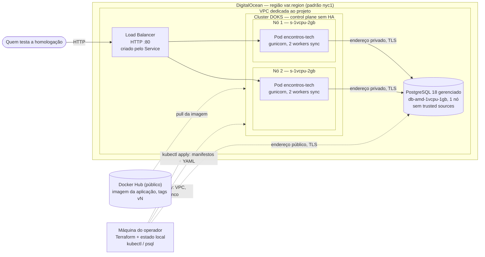

# TRD — Technical Requirements Document

> Documento técnico global do projeto Encontros Tech. Criado e atualizado via skill `escrever-trd`.
> Granularidade baixa: cobre o que é global e estável. Regras finas ficam em ADRs.
>
> **Contexto do ciclo atual:** porte da aplicação de um servidor com systemd para imagem
> Docker, Docker Compose local e manifestos Kubernetes, com banco PostgreSQL gerenciado na
> DigitalOcean, **sem alteração do código da aplicação** ([ADR 004](adrs/004-porte-sem-alteracao-de-codigo.md)).
> O ambiente na DigitalOcean é de **homologação de um MVP**, não de produção, dimensionado para
> custo baixo e provisionado com Terraform ([ADR 007](adrs/007-rede-vpc-dedicada-homologacao.md),
> [ADR 008](adrs/008-terraform-estado-local-aplicacao-manual.md), [ADR 009](adrs/009-homologacao-otimizada-para-custo.md)).
>
> Os manifestos Kubernetes seguem o padrão definido em
> [Padrão dos manifestos Kubernetes](#padrão-dos-manifestos-kubernetes).
>
> Marcações: **[Verificado — fonte, data]** fato externo consultado; **[premissa]** inferido na
> consolidação, aceito pelo responsável, mas ainda passível de correção.

---

## Stack

| Dimensão | Valor |
|---|---|
| Linguagem principal | Python 3.12 (`.python-version`; `requires-python >=3.12,<3.14`) |
| Runtime / plataforma | Contêiner Docker (Python 3.12 slim) em Kubernetes gerenciado da DigitalOcean (DOKS), versão `1.37.2-do.0` como valor inicial **[premissa: DOKS]** **[Verificado — `doctl kubernetes options versions`, 2026-11-17]** |
| Framework principal | Flask 3.0.0, servido por gunicorn 21.2.0 |
| Banco de dados | PostgreSQL 18 gerenciado da DigitalOcean (homologação) **[Verificado — `doctl databases options versions`: 15 a 18, 2026-11-17]**; PostgreSQL 18 em contêiner (local) |
| Acesso a dados | SQLAlchemy 2.0.43 + psycopg2-binary 2.9.10; validação com Pydantic 2.11.7 |
| Ferramentas de build | Docker (imagem single-stage) |
| Infraestrutura como código | Terraform ≥ 1.17 com provider `digitalocean` ~> 2.108, estado local, aplicado manualmente **[Verificado — registry.terraform.io e checkpoint-api.hashicorp.com: Terraform 1.17.2, provider 2.108.0, 2026-11-17]** ([ADR 008](adrs/008-terraform-estado-local-aplicacao-manual.md)) |
| Gerenciador de pacotes | uv (`pyproject.toml` + `uv.lock`, `package = false`) |
| Registry de imagens | Docker Hub, repositório público, tags sequenciais `v1`, `v2`, `v3`… ([ADR 010](adrs/010-imagem-docker-hub-publico-tags-sequenciais.md)) |
| Orquestração | Kubernetes, manifestos em YAML puro aplicados com `kubectl` ([ADR 002](adrs/002-manifestos-kubernetes-yaml-puro.md)) |

---

## Arquitetura

### Padrão arquitetural

Monólito web em camadas (routers → services → models), com páginas server-side (Jinja2) e uma
API JSON no mesmo processo. A aplicação não guarda estado próprio: todo o estado fica no
PostgreSQL, o que permite rodar várias réplicas sem coordenação entre elas.

### Estrutura de pastas dominante

```
encontros-tech/
├── pyproject.toml / uv.lock  # dependências (uv); raiz é o contexto de build da imagem
├── docs/                     # TRD e ADRs
└── src/                      # código da aplicação (diretório de trabalho do gunicorn)
    ├── main.py               # app Flask, métricas, create_all no import
    ├── core/                 # settings (env), database (engine/sessão), logging
    ├── routers/              # api_router (/api/events) e page_router (páginas HTML)
    ├── services/             # regras de negócio de eventos
    ├── models/               # modelos SQLAlchemy
    ├── schemas/              # schemas Pydantic
    ├── templates/ static/    # Jinja2, CSS, JS
    └── tests/                # pytest
```

### Módulos / camadas principais

| Módulo | Responsabilidade |
|---|---|
| `routers` | HTTP: API JSON em `/api/events` e páginas HTML |
| `services` | Operações de evento (criar, listar, editar via `edit_token`) |
| `models` / `schemas` | Persistência (SQLAlchemy) e validação (Pydantic) |
| `core` | Configuração por variáveis de ambiente, engine do banco, logging no stdout |

### Infraestrutura na DigitalOcean (homologação)



| Recurso | Definição | Criado por |
|---|---|---|
| VPC | Dedicada ao projeto, na região `var.region` (padrão `nyc1`). Mudar a região = destruir e recriar tudo ([ADR 007](adrs/007-rede-vpc-dedicada-homologacao.md)) | Terraform |
| Cluster DOKS | VPC-native, sub-redes de pods /16 e services /19 sem sobrepor nenhuma VPC do time **[premissa: tamanhos padrão]**; `ha = false` explícito; versão por variável (inicial `1.37.2-do.0`), patch automático ligado; `destroy_all_associated_resources = true`; API sem `control_plane_firewall` ([ADR 009](adrs/009-homologacao-otimizada-para-custo.md)) | Terraform |
| Node pool | 2 nós `s-1vcpu-2gb`, sem autoscaling | Terraform |
| Banco | PostgreSQL 18, `db-amd-1vcpu-1gb`, 1 nó sem standby, sem trusted sources (aceita qualquer origem — risco aceito) | Terraform |
| Load Balancer | Um, criado pelo Service `LoadBalancer` dentro da VPC ([ADR 003](adrs/003-exposicao-service-loadbalancer.md)) | Kubernetes (Service) |
| Aplicação | Namespace, Deployment, Service e ConfigMap em YAML puro ([ADR 002](adrs/002-manifestos-kubernetes-yaml-puro.md)); Secret criado à mão | `kubectl` |

**Fronteira Terraform × kubectl:** a `DATABASE_URL` vem do output `private_uri` do banco e é
colocada **manualmente** no Secret ([ADR 008](adrs/008-terraform-estado-local-aplicacao-manual.md)).
O estado do Terraform e os `*.tfvars` contêm segredos e nunca são commitados.

### Topologia de execução

**Homologação (Kubernetes):**

| Componente | Definição |
|---|---|
| Namespace | `encontros-tech`, dedicado; nada da aplicação vai para o `default` **[premissa]** |
| Deployment | 2 réplicas (uma por nó, quando o scheduler distribuir **[premissa]**); gunicorn com **2 workers sync** por pod, ouvindo em `0.0.0.0:8000`, `main:app`, com o diretório de trabalho em `src/` ([ADR 005](adrs/005-orcamento-de-conexoes-worker-sync-sem-pgbouncer.md)). Imagem do Docker Hub com tag `vN`, nunca `latest` ([ADR 010](adrs/010-imagem-docker-hub-publico-tags-sequenciais.md)). Estratégia `RollingUpdate` padrão, sem `minReadySeconds`: com 2 réplicas, o padrão arredonda `maxUnavailable` para 0 e `maxSurge` para 1 |
| Service | Tipo `LoadBalancer` (provisiona um Load Balancer da DigitalOcean), HTTP, sem TLS e sem domínio neste ciclo — acesso pelo IP do Load Balancer ([ADR 003](adrs/003-exposicao-service-loadbalancer.md)) |
| ConfigMap | Configuração não sensível: `APP_TITLE`, `DEBUG=false`, `LOG_LEVEL`, `LOG_FORMAT`, `SERVICE_NAME`, `SERVICE_VERSION`. `SERVICE_VERSION` usa o mesmo `vN` da tag da imagem **[premissa]** |
| Secret | `DATABASE_URL` completa, com o **host privado** do banco (usuário, senha, host, porta e `sslmode=require`). **Criado à mão** no namespace com as credenciais do banco; não existe em nenhum YAML do repositório. Confirma a premissa registrada no [ADR 002](adrs/002-manifestos-kubernetes-yaml-puro.md) |
| Probes | **Nenhuma** (liveness, readiness e startup), por simplicidade. Substitui a probe `tcpSocket` citada nas consequências do [ADR 004](adrs/004-porte-sem-alteracao-de-codigo.md). Custo aceito: ver [Padrão dos manifestos Kubernetes](#padrão-dos-manifestos-kubernetes) |
| Banco | PostgreSQL gerenciado da DigitalOcean, fora do cluster e dentro da mesma VPC ([ADR 001](adrs/001-banco-postgresql-gerenciado-digitalocean.md), [ADR 007](adrs/007-rede-vpc-dedicada-homologacao.md)) |

**Local (Docker Compose):** serviço da aplicação (mesma imagem) + serviço PostgreSQL 18 com
volume, configurados a partir de `.env` (modelo em `.env.exemple`).

### Padrão dos manifestos Kubernetes

Regras que todo manifesto da aplicação segue. Escopo: **homologação**; não há validação
automática dos YAMLs neste ciclo (kubeconform, kube-linter) — a conferência é na revisão.

| Regra | Definição |
|---|---|
| Formato | YAML puro aplicado com `kubectl apply` ([ADR 002](adrs/002-manifestos-kubernetes-yaml-puro.md)); um recurso por arquivo (Namespace, Deployment, Service, ConfigMap) **[premissa]** |
| Namespace | Todo recurso declara `namespace: encontros-tech` **[premissa]** |
| Labels | Labels recomendadas `app.kubernetes.io/*` (`name`, `instance`, `version`, `component`, `part-of`, `managed-by`) em todos os recursos; o `selector` do Deployment e do Service usa só labels estáveis (sem `version`) **[premissa]** |
| Imagem | `<usuário>/<repositório>:vN` do Docker Hub público, sem `imagePullSecret`; tag publicada nunca é sobrescrita; nunca `latest` ([ADR 010](adrs/010-imagem-docker-hub-publico-tags-sequenciais.md)) |
| Versão | Deploy = trocar a tag `vN` no Deployment **e** o `SERVICE_VERSION` no ConfigMap, e aplicar os dois **[premissa]** |
| Probes | Nenhuma, por **simplicidade** — decisão do responsável. Não adicionar probes sem rever esta regra. Custo aceito: (1) sem readiness, o pod novo entra no Load Balancer assim que o contêiner sobe, antes de o gunicorn abrir a porta 8000 — por alguns segundos a cada rollout, parte das requisições recebe recusa de conexão ou 502; (2) sem liveness, um processo travado sem cair continua recebendo tráfego. Processo que **morre** (ex.: `create_all` falhando) é reiniciado pela `restartPolicy`, sem precisar de probe. O `HEALTHCHECK` do Dockerfile é ignorado pelo Kubernetes e vale só no Compose |
| Recursos | Todo contêiner declara `requests` e `limits` de CPU e memória; valores definidos no manifesto, compatíveis com nós `s-1vcpu-2gb` e 1 pod por nó **[premissa]** |
| securityContext | `runAsNonRoot: true` com `runAsUser: 1001` (o Dockerfile declara `USER app` pelo nome; sem UID numérico o kubelet não consegue confirmar que não é root e recusa o contêiner); `allowPrivilegeEscalation: false`; `capabilities.drop: [ALL]`; `readOnlyRootFilesystem: true` com `/tmp` montado como `emptyDir`, porque o código grava métricas lá **[premissa]** |
| Secret | Criado à mão antes do primeiro deploy, no namespace `encontros-tech`, com a chave `DATABASE_URL` tirada do output `private_uri` do Terraform; o Deployment só referencia o Secret pelo nome |
| Schema | Sem Job nem initContainer de schema: vale o `create_all` no import ([ADR 006](adrs/006-estrategia-de-schema-e-migrations.md), em aberto) |

### Imagem Docker

- Base Python 3.12 slim, **single-stage**: o `uv` e o `uv.lock` entram só como mount de build
  (`uv sync --frozen --no-dev`), sem ficar em nenhuma camada; a imagem leva o ambiente e `src/`.
- Publicada no Docker Hub, repositório público, com tag `vN` ([ADR 010](adrs/010-imagem-docker-hub-publico-tags-sequenciais.md)).
  Como é pública, nada sensível entra nela: credenciais só pelo Secret, nenhum `.env` copiado.
- Executa como usuário não-root `app` (UID 1001); `/tmp` gravável (o código cria o diretório de métricas lá).
- Contexto de build na raiz do repositório (o `uv.lock` fica na raiz; o Dockerfile antigo, removido
  em `0f5bbad`, usava `src/` e `requirements.txt`).

### Inicialização do schema

`create_all` roda no import de `main.py`, em todo processo. Com 2 réplicas × 2 workers subindo
juntos, um pod pode reiniciar uma vez no primeiro deploy (risco aceito). A estratégia definitiva
está **em aberto** ([ADR 006](adrs/006-estrategia-de-schema-e-migrations.md)).

---

## Requisitos Não-Funcionais

| Dimensão | Requisito |
|---|---|
| Performance | Não definido |
| Custo | Restrição declarada: homologação otimizada para custo baixo — control plane sem HA, 2 nós do menor tamanho, banco de 1 nó sem standby ([ADR 009](adrs/009-homologacao-otimizada-para-custo.md)) |
| Disponibilidade / SLA | Sem SLA (homologação). 2 réplicas em 2 nós, para manter a aplicação no ar durante o rolling update e se um nó cair. Sem HA no control plane nem standby no banco: falha do banco derruba o ambiente. Sem probes: a cada rollout há uma janela curta em que parte das requisições falha (ver [Padrão dos manifestos Kubernetes](#padrão-dos-manifestos-kubernetes)), e processo travado não é reiniciado. Backup diário do banco fica com a DigitalOcean; dados de homologação são descartáveis **[premissa]**. Backup do estado do Terraform é responsabilidade do operador, fora do escopo |
| Escalabilidade | Escalar por réplicas, não por workers. Limite dado pela regra de conexões: `(réplicas + surge) × workers × conexões por worker ≤ conexões do plano − folga`. Hoje: (2 + 1) × 2 × 1 = 6 de 22 no plano de 1 GiB. Passou do limite → PgBouncer ou plano maior, via ADR novo ([ADR 005](adrs/005-orcamento-de-conexoes-worker-sync-sem-pgbouncer.md)). Sem autoscaling neste ciclo |
| Segurança | Conexão com o banco por TLS (`sslmode=require`) **[Verificado — DigitalOcean, How to Connect, 2026-11-16]**; aplicação → banco pelo endereço privado da VPC; credenciais só em Secret criado à mão, fora do repositório; contêiner com `runAsNonRoot`, sem escalada de privilégio, sem capabilities e com sistema de arquivos somente leitura; estado do Terraform e `*.tfvars` fora do Git; imagem não-root. Riscos aceitos: banco sem trusted sources (aceita conexão de qualquer origem) e API do cluster sem firewall ([ADR 007](adrs/007-rede-vpc-dedicada-homologacao.md)) — desenho não serve para produção; `SECRET_KEY` fixa no código; imagem pública no Docker Hub (o código de `src/` fica visível) ([ADR 010](adrs/010-imagem-docker-hub-publico-tags-sequenciais.md)); tráfego público em HTTP sem TLS; o `edit_token` aparece em log de nível INFO no service de eventos |
| Observabilidade | Logs em texto no stdout (sem cor fora de TTY). Métricas Prometheus em `/metrics` na porta da aplicação, refletindo só o worker que atendeu (risco aceito; `PROMETHEUS_MULTIPROC_DIR` não deve ser definida no contêiner). A coleta pelo Prometheus fica fora do escopo deste ciclo |

---

## Dependências Externas

| Serviço / Sistema | Tipo | Constraint relevante | Dono |
|---|---|---|---|
| PostgreSQL gerenciado — DigitalOcean | Banco relacional via TCP/TLS | Conexões por plano: 1 GiB = 22, 2 GiB = 47, 4 GiB = 97 (3 já reservadas para manutenção); sem `superuser`; padrão `sslmode=require`; porta lida dos dados de conexão do cluster; PgBouncer gerenciado disponível (modo transaction por padrão, até 21 pools por cluster); versões 15 a 18 em clusters novos, 18 como padrão **[Verificado — docs.digitalocean.com: [Limits](https://docs.digitalocean.com/products/databases/postgresql/details/limits/), [Connect](https://docs.digitalocean.com/products/databases/postgresql/how-to/connect/), [Connection Pools](https://docs.digitalocean.com/products/databases/postgresql/how-to/manage-connection-pools/), [Version Support Policy](https://docs.digitalocean.com/products/databases/version-support-policy/), 2026-11-16]** | externo — DigitalOcean |
| Kubernetes — DOKS | Plataforma de execução | Service `LoadBalancer` cria um Load Balancer pago por Service **[premissa: cluster DOKS]**. Cluster e Load Balancer não migram de VPC; sub-redes VPC-native fixadas na criação, sem sobreposição com VPCs do time e sem ampliação; control plane HA ligado por padrão a partir da 1.36 e irreversível; menor nó `s-1vcpu-2gb` **[Verificado — docs.digitalocean.com (VPC, DOKS) e docs do provider Terraform via Context7; `doctl`, 2026-11-17]** | externo — DigitalOcean |
| VPC — DigitalOcean | Rede privada | Regional: só recursos da mesma região; banco gerenciado pode migrar de VPC, cluster e Load Balancer não **[Verificado — docs.digitalocean.com, VPC, via Context7, 2026-11-17]** | externo — DigitalOcean |
| Terraform + provider `digitalocean` | Provisionamento | Estado local com segredos em texto puro; sem lock de concorrência (operador único) ([ADR 008](adrs/008-terraform-estado-local-aplicacao-manual.md)) | externo — HashiCorp / DigitalOcean |
| Docker Hub | Registry de imagens | Repositório público, pull anônimo pelo cluster. Limite de pull anônimo: 100 a cada 6 horas por IPv4 (ou sub-rede IPv6 /64); conta pessoal autenticada: 200 **[Verificado — [Docker Hub pull usage and limits](https://docs.docker.com/docker-hub/usage/pulls/), 2026-11-17]**. Com 2 nós e poucos deploys, longe do limite ([ADR 010](adrs/010-imagem-docker-hub-publico-tags-sequenciais.md)) | externo — Docker |

---

## Padrões

### Testes

| Item | Valor |
|---|---|
| Framework | pytest 8.3.4 (grupo `dev`) |
| Comando completo | `uv run pytest` (config em `pyproject.toml`: `pythonpath = ["src"]`, `testpaths = ["src/tests"]`) |
| Cobertura mínima | Não definida |
| Estratégia | Testes unitários de service com sessão do banco mockada (`MagicMock`); sem integração nem E2E automatizados. Os testes não entram na imagem de produção |

### Estilo de código

- **Linter:** não configurado
- **Formatter:** não configurado
- **Convenções de nomenclatura:** snake_case para funções e módulos, PascalCase para classes (PEP 8)

### Error handling

Erros de domínio são exceções explícitas (ex.: `EventNotFoundError`). Os routers convertem
`ValueError` em 400 e exceções genéricas em 500 com `abort`, logando o erro antes.

### Logging

- **Formato:** texto `asctime | level | name | func:line | message` no stdout; cor só em TTY
- **Nível padrão:** `INFO` (`DEBUG` quando `DEBUG=true`), ajustável por `LOG_LEVEL`
- **Biblioteca:** `logging` da stdlib, com helpers em `core/logging.py` (`log_request`, `log_business_event`, `log_database_operation`)

### Configuração

Toda a configuração vem de variáveis de ambiente lidas em `core/settings.py` (com `.env` opcional
via python-dotenv). No contêiner, as variáveis vêm do ConfigMap e do Secret; nenhum `.env` entra
na imagem.

### Autenticação / autorização

Não há autenticação de usuário. A edição de um evento é autorizada pela posse do `edit_token`
(UUID gerado na criação).

---

## Decisões Globais (ADRs)

| # | Título | Data | Status | Link |
|---|--------|------|--------|------|
| 001 | Banco PostgreSQL gerenciado na DigitalOcean, fora do cluster | 2026-11-16 | aceito | [001](adrs/001-banco-postgresql-gerenciado-digitalocean.md) |
| 002 | Manifestos Kubernetes em YAML puro | 2026-11-16 | aceito | [002](adrs/002-manifestos-kubernetes-yaml-puro.md) |
| 003 | Exposição da aplicação por Service do tipo LoadBalancer | 2026-11-16 | aceito | [003](adrs/003-exposicao-service-loadbalancer.md) |
| 004 | Porte para contêiner sem alterar o código da aplicação | 2026-11-16 | aceito | [004](adrs/004-porte-sem-alteracao-de-codigo.md) |
| 005 | Orçamento de conexões com worker sync e sem PgBouncer | 2026-11-16 | aceito | [005](adrs/005-orcamento-de-conexoes-worker-sync-sem-pgbouncer.md) |
| 006 | Estratégia de criação do schema e migrations | 2026-11-16 | proposto | [006](adrs/006-estrategia-de-schema-e-migrations.md) |
| 007 | Rede da homologação — VPC dedicada, banco por endereço privado e acesso público aceito | 2026-11-17 | aceito | [007](adrs/007-rede-vpc-dedicada-homologacao.md) |
| 008 | Infraestrutura em Terraform, com estado local e aplicação manual | 2026-11-17 | aceito | [008](adrs/008-terraform-estado-local-aplicacao-manual.md) |
| 009 | Ambiente de homologação dimensionado para custo baixo | 2026-11-17 | aceito | [009](adrs/009-homologacao-otimizada-para-custo.md) |
| 010 | Imagem publicada no Docker Hub, repositório público, com tags sequenciais | 2026-11-17 | aceito | [010](adrs/010-imagem-docker-hub-publico-tags-sequenciais.md) |
